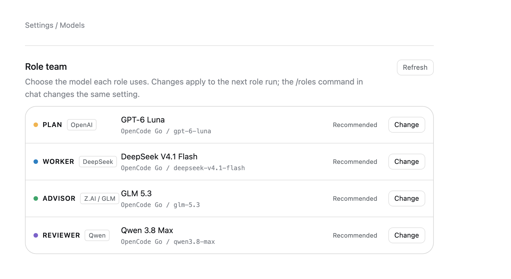
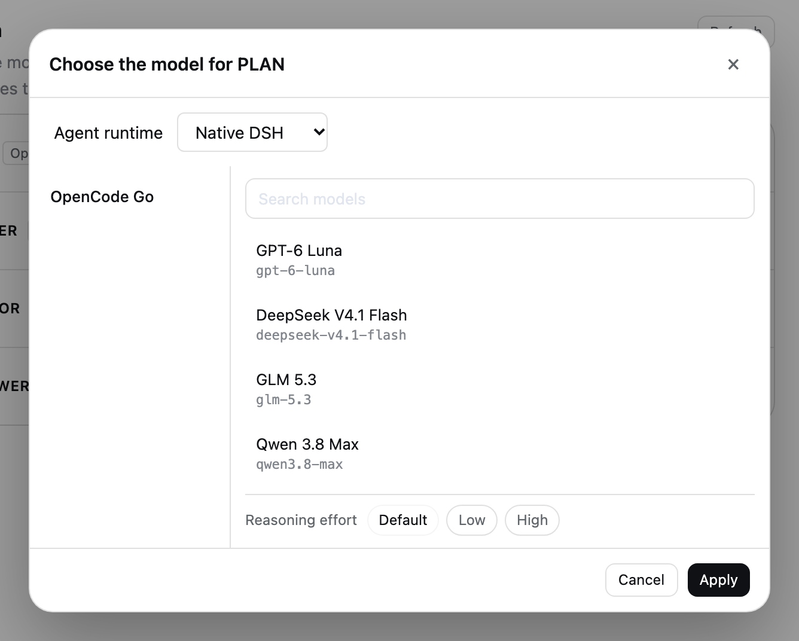
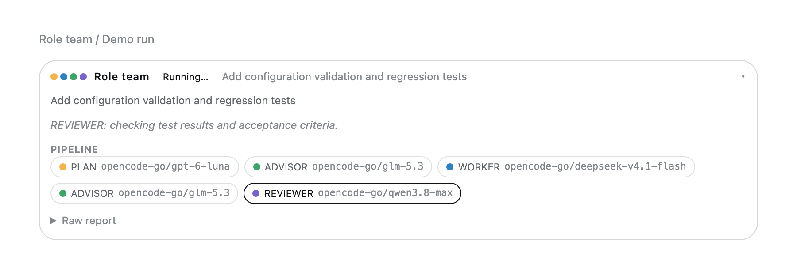
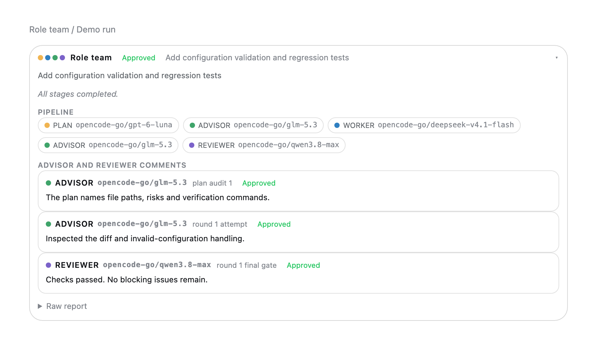

# Role team

[English](README.md) · [Русский](README.ru.md)

A four-role working model for DeepSeek Harness, ported from omp (oh-my-pi):
**PLAN** designs, **WORKER** implements, **ADVISOR** audits every attempt from
another model family, and **REVIEWER** is the final independent gate. Each role
runs as a real DSH subagent with its own model and provider, and the bundled
`roles_start` and `roles_run` tools drive the loop until the reviewer approves or the round
limit is reached.

## Interface

The images show the shipped components with deterministic demonstration data,
using the DSH theme. No live provider or user session is involved. See the
[capture instructions](docs/preview/README.md) to reproduce them.

**Settings → Models:** choose a separate model for each role.



**Model picker:** runtime, provider, model search and reasoning effort.



**Background pipeline:** the settled `roles_start` card keeps updating; the
currently active role is highlighted.



**Final report:** the same background card updates to show independent ADVISOR
and REVIEWER verdicts and comments.



## What it adds

Model-facing tools:

- `roles_start` — start the full team in the background and return immediately,
  leaving the orchestrator available for conversation.
- `roles_status` — inspect the run and the active role's latest progress. Use
  this when the user asks “what's happening?” or “чё там, как там?”.
- `roles_cancel` — cancel the current session's background run and release its
  active child.

- `roles_run` — the full team loop on one self-contained task. PLAN drafts a
  rigorous plan, the ADVISOR audits that plan before WORKER starts (a rejected
  plan is revised from the advisor's issues), WORKER implements it in the
  shared workspace, ADVISOR audits every worker attempt, and REVIEWER is the
  final gate whose approval is the only approved outcome. When the rounds run
  out without approval the run asks the user how to proceed: continue without
  approval, try three more rounds, change the WORKER model (with a model
  choice), or stop. Returns the plan, every attempt, every verdict, the user's
  decisions and the final status.
- `role_plan`, `role_worker`, `role_advisor`, `role_reviewer` — run a single role
  once and return its report. Useful when the lead wants one plan, one audit or
  one final review without the whole loop.

Chat commands:

- `/roles` — show the routes, loop limits and their sources.
- `/roles set <role> <provider>/<model>[:effort] | inherit` — validate the route against
  the live LLM runtime (or set `inherit`), then persist it in the profile patch.
  Runtime routes use `cursor:<model>` or `droid:<model>`.
- `/roles fallback <role> <route> [<route> ...] | clear` — replace a role's ordered
  fallback chain. Each route is validated first; the role tries its primary route,
  then each fallback when validation or execution fails. The settings page edits the
  same chain.
- `/roles inherit <role>` — configure the role to inherit the caller's session model.
- `/roles reset <role>` — remove a saved override and fall back to the
  recommended default (or the inherited session model).
- `/roles config [maxRounds|maxPlanPasses|childMaxDepth] [value]` — inspect or persist
  the loop limits (`maxRounds` 1–6, `maxPlanPasses` 1–3, `childMaxDepth` 0–8).
- `/roles models [provider|runtime]` — list registered LLM providers, their advertised
  models, and the Cursor/Factory Droid runtime catalogs, so primary and fallback route
  ids are discoverable.
- `/roles doctor` — validate every route in parallel and warn when the worker, advisor and
  reviewer are not from independent model families.
- `/roles run <task>` — start the full team in the background.
- `/roles status [run-id]` — inspect a background run in this session (along with recent session runs).
- `/roles list` — list recent background runs in this session.
- `/roles cancel [run-id]` — cancel a background run in this session.
- `/role-plan [--plan <plan.md>] <task or plan.md>` — start the full role-team process on demand,
  instead of the lead agent's ordinary execution. With a task, PLAN writes the
  plan; with a path to a Markdown plan file (passed as a single `.md` path, an existing leading `.md` file + custom task, or via `--plan <plan.md> [task]`,
  resolved against the session workspace), the plan is read from the file and
  PLAN is skipped. The command does not run the pipeline in the session that
  typed it: it creates a dedicated session in the same working directory, hands
  it one prompt that calls `roles_start` with the exact task and plan, and returns
  at once. The workspace opens that session automatically, so the live roles
  card and the whole run stay there. Both sessions remain available for chat;
  ask for progress in the session that owns the run.

## Keep the orchestrator available

Use `/roles run <task>` in the current session, or `/role-plan <task or plan.md>`
to open a dedicated session. The orchestrator calls `roles_start` and returns
without waiting for the pipeline. You can then write **“чё там, как там?”** or
**“what's the progress?”** in that session. Its guidance tells it to call
`roles_status` before answering.

`roles_start` accepts the same `task`, optional `context`, `plan` and
`max_rounds` arguments as `roles_run`. It returns a `runId`. Only one background
run may be active in a session.

`roles_status` accepts an optional `run_id`; omitted, it selects the latest run
in the current session. It reports the active role and route, completed stages,
observed child activity, and the final report when finished. For example:

```json
{
	"run_id": "<runId>",
	"question": "What is done, what remains, and are you blocked?"
}
```

The optional `question` (up to 2,000 characters) is sent to the active native
child's inbox. `questionSent: true` confirms acceptance by the inbox; it does
not mean the child has already answered. Read status again for subsequent
observed activity. External runtime activity can be inspected, but status
questions cannot be sent to external children.

Use `roles_cancel` with optional `run_id`, or `/roles cancel [run-id]`, to abort
the current session's run and release its active child. Run IDs do not grant
access to another session's runs. Finished runs are retrieved through status;
there is no automatic completion message to the orchestrator.

Background state is held in memory. When starting a run with 100 or more records,
the plugin evicts older completed records; active runs are retained. A plugin reload aborts active background runs and clears their
records; restarting does not resume them. Completed tool results already
stored in the timeline remain ordinary session history.

## Default routes

The recommended setup keeps all four roles on the configured OpenCode Go
route but uses four different model families:

| Role     | Default route                     | Family   | Why                                      |
| -------- | --------------------------------- | -------- | ---------------------------------------- |
| PLAN     | `opencode-go/gpt-6-luna`          | OpenAI   | strong planning model                    |
| WORKER   | `opencode-go/deepseek-v4.1-flash` | DeepSeek | fast, cheap implementer                  |
| ADVISOR  | `opencode-go/glm-5.3`             | ZAI      | a different family from the worker       |
| REVIEWER | `opencode-go/qwen3.8-max`         | Qwen     | independent from both worker and advisor |

The defaults deliberately use the provider that is configured in this profile,
while keeping the four families distinct. When another provider is available
(for example Codex with GPT-6 Astra, or Anthropic with Claude Opus), point a
role at it with `/roles set`; the role model and provider are independent of
the others.

Change any route with `/roles set` or from **Settings → Models**. A role set to
`null` (or `"inherit"`) follows the caller's session model; this is useful when
a provider is not configured. The plugin also accepts `roles` in
`cordis.patch.yml`:

```yaml
- id: role-team
  name: "@local/dsh-role-team"
  config:
    roles:
      plan: { provider: anthropic, model: claude-opus-5, reasoningEffort: high }
      worker: { provider: opencode-go, model: deepseek-v4.1-flash }
      advisor: { provider: zai, model: glm-5.3 }
      reviewer: { provider: openai-codex, model: gpt-6-sol }
    maxRounds: 3 # worker attempts per run, 1-6
    maxPlanPasses: 2 # ADVISOR plan-audit passes before WORKER, 1-3
    childMaxDepth: 2 # delegation depth available to role children
    prompts: # optional extra instructions per role
      worker: "Prefer the repository conventions over new abstractions."
    fallbacks: # ordered alternatives when a route is unavailable or fails
      worker:
        - { provider: zai, model: glm-5.3 }
        - "cursor:claude-opus-5.5"
      advisor: "droid:gpt-6.1-sol"
```

Compact `provider/model[:effort]` strings work too. Routes are validated with
the adapter before a run starts, so an unknown provider, model or reasoning
effort fails with the role name and route instead of starting a child. Route
validation does not test credentials: a provider that is registered but not
signed in fails on the first role request with its own diagnostic.

A fallback chain is tried in order: the primary route first, then each
configured fallback after a validation or execution failure. The route that
actually ran is sticky for later rounds and is named in the stage status, the
final report (`..., fallback`), and the subagent's title (`role advisor ·
opencode-go/glm-5.3`), so a finished task always shows which model did it.
`/roles doctor` validates fallback routes too.

## Settings → Models

The package ships a browser half, so **Settings → Models** gains a **Role team**
section below the provider cards:

- one row per role with the model name, the exact `provider/model` route, the
  reasoning effort, the fallback chain, and a **Recommended / Custom / Inherits
  the session model** badge;
- **Change** opens a picker over the live adapter catalogue: provider list,
  model search, the model's reasoning efforts (with **Default** meaning no
  explicit effort), and an **Inherit session model** button;
- **Fallbacks** opens the same picker in chain mode: applying appends a route to
  the ordered chain, and each entry can be removed or cleared;
- **Reset** removes a saved route and returns the role to the recommended
  default;
- **Loop limits** lets you adjust `maxRounds` (1–6), `maxPlanPasses` (1–3), and
  `childMaxDepth` (0–8) directly from the page;
- the section shows the same cross-family warnings as `/roles doctor`, validates
  routes on refresh, and marks a stored route that no routable provider
  advertises as not currently available.

The picker also supports **Cursor** and **Factory Droid** when the matching
`agentRuntime` is installed in the profile. Their runtime catalogs are loaded on
demand and shown as a searchable model list; a free-text model ID remains
available for a new or unlisted model. Runtime routes execute in an isolated
copy and report its path and artifacts. Their changes are not applied to the
source workspace automatically.

Changes save immediately through the same profile configuration editor as
`/roles set`, so the chat command and the page stay one source of truth. The
page needs a browser refresh after the bundle is installed or its client half
changes.

## Installation

Requires Node.js 22.13 or newer. From a source checkout, install the pinned
build tools and compile before adding or linking the directory:

```sh
npm ci
```

The `prepare` lifecycle builds TypeScript into `dist/`. After editing sources,
run `npm run build` before reloading the plugin. `npm pack` also builds before
creating the bundle; the archive includes JavaScript, locales, documentation,
and the license, with `xstate` as the runtime state-machine dependency. A copied
or `link:` directory must include its built `dist/` and production
`node_modules/`; DSH does not compile this package. The workstation macOS
installer builds its staged copy automatically; Nix builds it from the npm lockfile.

Install the directory through **Plugins → Add plugin**, or with the plugin
manager:

```
plugin_manager action=install_bundle target=/absolute/path/to/dsh-role-team
```

The bundle inserts one Host row, `role-team`. It requires the subagent service
and the in-process `spawn` provider (both are in the standard Desktop and Web
presets). Persisting `/roles set` additionally requires the profile
configuration editor; without it, edit the `role-team` row in
`cordis.patch.yml` directly.

## How the loop works

The orchestration, background run lifecycle, fallback chain, and external
runtime sessions are modeled as explicit XState v5 state machines; see
[docs/ARCHITECTURE.md](docs/ARCHITECTURE.md) for the layered module layout and
state diagrams.

1. **PLAN** receives the task verbatim plus optional context and returns a plan
   with four labeled parts: `STEPS` (each naming the exact file or module path
   and the concrete change), `RISKS` (named risks and edge cases, each stating
   what to verify), `VERIFY` (the exact commands that prove completion) and
   `ACCEPT` (acceptance checks an independent reviewer can verify).
2. **Plan audit** — the ADVISOR audits the plan itself before any WORKER
   attempt. A rejected plan goes back to PLAN with the advisor's issues
   (bounded by `maxPlanPasses`, default 2); issues that survive every pass are
   carried into the WORKER prompt.
3. **WORKER** receives the task, the plan, and the outstanding advisor/reviewer
   feedback. It runs as a fresh agent with the caller's normal tools, edits the
   shared workspace, runs checks, and must end with `CHANGES:`, `EVIDENCE:`,
   `STATUS: done|blocked` and `NOTES:`.
4. **ADVISOR** inspects the real workspace and diff from a different model
   family. It returns strict JSON: `approved`, `summary`, `issues[]`. A
   rejection feeds every issue into the next WORKER attempt.
5. **REVIEWER** runs only after ADVISOR approves. It verifies the diff and tests
   from scratch, with the plan, the worker report and the advisor verdict, and
   returns the same strict JSON. A rejection also returns to WORKER and the
   loop repeats. The REVIEWER's approval is the run's only APPROVED verdict.
6. When the rounds are exhausted without approval, the run asks the user how to
   proceed — continue without approval, try three more rounds, change the
   WORKER model (followed by a model choice from the live catalogue), or stop.
   Extra rounds respect a hard cap of 12 total worker attempts; the decision is
   recorded in the report. Without an interactive answerer the run ends
   NOT APPROVED with a note.
7. The report is verdict-first: the status header, then the labeled ADVISOR and
   REVIEWER comment sections (each with the stage's route), then the plan, the
   round-by-round detail, and the user's decisions.

The same gate applies to the standalone tools: `role_reviewer` refuses to start
until `role_worker` (or a `roles_run` worker) has reported completion in that
session, so the gate cannot be used as a first reviewer by accident.

## Role cards in the chat timeline

The browser half registers dedicated cards for the role tools in the chat
timeline (keyed `tool.call.toolview` rows):

- a role badge with the stage's provider/model route and duration, and a status pill
  (running, awaiting your decision, approved, changes required, continued without approval, failed);
- while a run is in flight (including collapsed `roles_start` cards, pausing when the browser tab is hidden), the card polls the live run state
  (`GET /plugin-api/role-team/run/<callId>`, loopback-guarded), shows the
  pipeline with the currently active role highlighted, and offers a **Cancel run** button for active background runs;
- once settled, the card reads the structured metadata persisted with the tool
  result and renders the ADVISOR and REVIEWER comments — verdict, summary and
  each issue with its severity — plus the user's exhaustion decisions, with the
  raw report behind a disclosure. When the metadata is absent (for example an
  older result), the card falls back to the raw report text.

The structured results also remain inspectable in the Trajectory view's Result
inspector, which shows the canonical value (stages, comments, decisions) next
to the rendered report.

Role children are started with caller delivery, so they do not send completion
notices into the lead's inbox; the tool result contains the complete report.
Children are disposed after each attempt to keep the subagent pool free.

## Independence

The point of the roles is that the auditor and the gate are not the worker's
model. `familyOf` classifies a route by its model id (Anthropic, OpenAI, Google,
ZAI/GLM, DeepSeek, Qwen, Kimi, Grok, MiniMax, Meta, Mistral) and
`/roles doctor` warns when WORKER/ADVISOR or WORKER/REVIEWER or
ADVISOR/REVIEWER share a family. The classification is a heuristic: a route
whose id does not reveal its family is treated as its provider id.

## Configuration and persistence

- Role routes are read from the plugin's Loader config. `/roles set` writes the
  complete current config through `ctx.configEditor.edit`, so the override
  lands in the active profile's `cordis.patch.yml` and survives restart.
- `maxRounds` is clamped to 1-6; `childMaxDepth` to 0-8. `roles_run` accepts a
  per-call `max_rounds` override.
- The prompt section explains the team tools to the lead. The
  tool schemas are visible to the lead and to role children; role prompts
  tell children not to call the role tools, and `childMaxDepth` prevents
  unbounded recursion.

## Limits

- `/roles doctor` and the Settings page check that each route resolves, not that
  its provider is authenticated. The first role run reports a missing credential
  or an unconfigured provider.
- The Settings page offers only providers the running profile can route. A
  route stored earlier for a now-unconfigured provider stays visible, marked
  unavailable, and can be reset or replaced.
- Role children inherit the caller's preset, tools and permission policy. The
  plugin does not create read-only presets for ADVISOR/REVIEWER; their prompts
  forbid edits, but the permission system still allows them. Use a
  read-only preset for the session if that must be enforced.
- Role children start fresh: they do not see the lead's conversation. Pass
  every fact they need in `task` and `context`.
- `roles_run` is a foreground tool call. It can take several minutes and spends
  tokens for every role in every round; the round limit is the budget guard.
  Use `roles_start` to keep the orchestrator conversational during the run.
- The standalone `role_reviewer` tool requires a completed `role_worker` call
  in the same session. It cannot tell whether the worker's claim of completion
  is true; it verifies from scratch, which is the point of the gate.
- `/roles set` triggers a Loader reload of the plugin row, which is safe while
  idle. Do not change routes in the middle of a run.
- The plugin imports no DSH packages; it resolves services from the live Host
  context. Loading requires `ctx.tools` and `ctx.systemPrompt`; native roles
  additionally need `ctx.subagents`, while external routes need `agentRuntime`.
  Commands and route persistence require their corresponding Host services.

## Development

```sh
npm ci
npm run check
```

`check` runs Oxfmt, type-aware Oxlint, strict TypeScript and all Node tests
against the emitted JavaScript. `npm run format` and `npm run lint:fix` apply
formatting and lint fixes. Tool versions and formatter/linter settings match
`extensions/omp/cursor`; see [CONTRIBUTING.md](CONTRIBUTING.md).

The suite uses a fake Host context and canned role outputs: it checks config
parsing, route validation failures, the plan-audit order and revision, the
strict pipeline order, feedback propagation, the reviewer gate, the four
exhaustion choices and their hard cap, `/role-plan` (task and plan-file forms,
the dedicated session it creates, its one-shot claim route and the failure
paths), `/roles set`/`reset` persistence, family warnings, the structured
presentation metadata, the live run-state route, the Settings snapshot, and the
settings route's GET/POST/reset and admission checks.

## License

[MIT](LICENSE).
