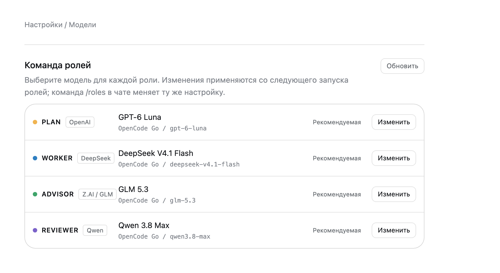
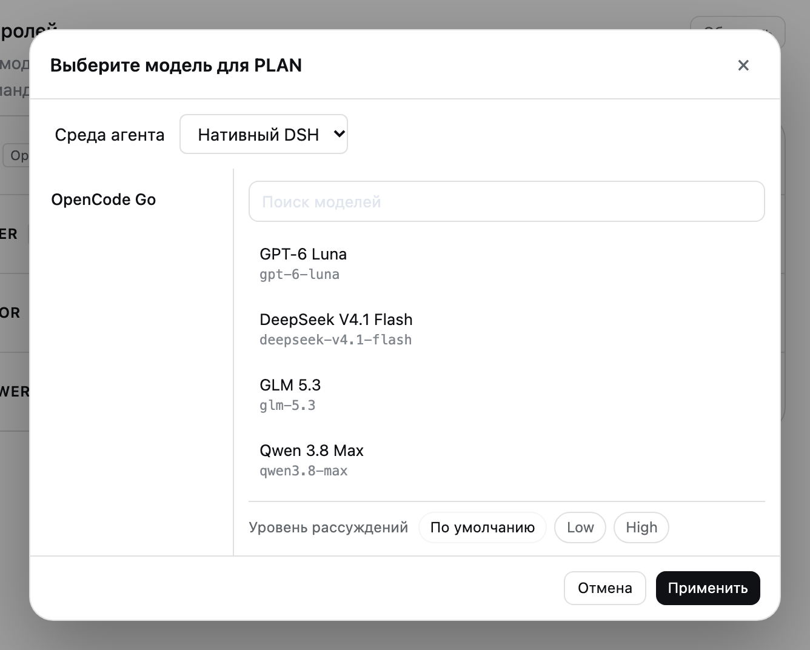
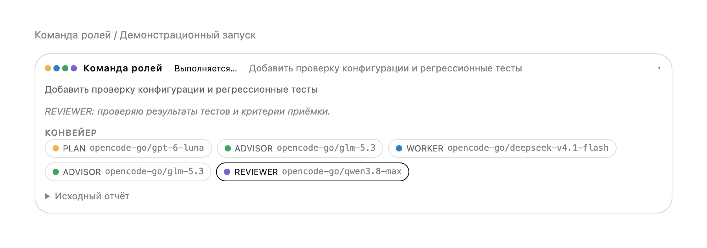
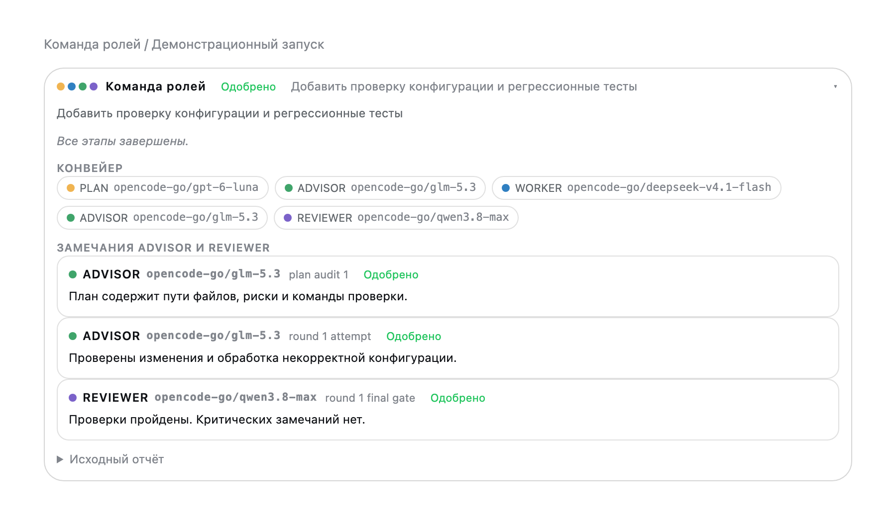

# Команда ролей

[English](README.md) · [Русский](README.ru.md)

Четыре роли для DeepSeek Harness, перенесённые из omp (oh-my-pi):
**PLAN** составляет план, **WORKER** реализует его, **ADVISOR** проверяет
каждую попытку моделью другого семейства, а **REVIEWER** принимает итоговую
работу. У каждой роли своя модель и провайдер. Оркестратор запускает роли,
передаёт замечания на доработку и сообщает результат.

## Интерфейс

На скриншотах — настоящие компоненты плагина с демонстрационными данными и
темой DSH. Живые провайдеры и пользовательские сессии не задействованы.
[Как воспроизвести скриншоты](docs/preview/README.md).

**Настройки → Модели:** отдельная модель для каждой роли.



**Выбор модели:** среда агента, провайдер, поиск и уровень рассуждений.



**Фоновый запуск:** карточка завершённого вызова `roles_start` продолжает
обновляться; текущая роль выделена в конвейере.



**Результат:** та же карточка обновляется и показывает независимые заключения
и замечания ADVISOR и REVIEWER.



## Быстрый старт

Нужен Node.js 22.13 или новее. Перед установкой каталога из исходников
выполните в нём:

```sh
npm ci
```

Скрипт `prepare` соберёт TypeScript в `dist/`. После правок выполните
`npm run build` перед перезагрузкой плагина. Команда `npm pack` также сначала
собирает пакет. Для копирования и подключения через `link:` нужен готовый
`dist/`: DSH сам исходники не компилирует. Установщик workstation для macOS
собирает свою промежуточную копию автоматически; Nix собирает расширение
по тому же npm lockfile. Рабочих npm-зависимостей
у расширения нет.

Установите каталог через **Плагины → Добавить плагин** или менеджер плагинов:

```text
plugin_manager action=install_bundle target=/absolute/path/to/dsh-role-team
```

Пакет добавляет строку Host `role-team`. Для нативных ролей нужны сервис
сабагентов и провайдер `spawn` в том же процессе — они входят в стандартные
Desktop/Web-пресеты. Для сохранения маршрутов через `/roles set` нужен
редактор конфигурации профиля. Если его нет, меняйте строку `role-team` в
`cordis.patch.yml` вручную. После установки обновите страницу браузера.

Запустите команду на задаче или готовом Markdown-плане:

```text
/role-plan Добавить проверку конфигурации и покрыть её регрессионными тестами.
/role-plan .dsh/jev/my-approved-plan.md
```

Путь к плану разрешается относительно рабочего каталога сессии. С готовым
планом роль PLAN пропускается, но ADVISOR всё равно проверяет план перед
реализацией. Команда создаёт отдельную сессию в том же рабочем каталоге и
возвращается сразу; браузер открывает созданную сессию автоматически.

## Инструменты оркестратора

| Инструмент      | Назначение                                                                                              |
| --------------- | ------------------------------------------------------------------------------------------------------- |
| `roles_start`   | Запускает полный цикл в фоне и сразу возвращает управление оркестратору.                                |
| `roles_status`  | Читает состояние запуска и свежий прогресс активной роли; используется для вопросов «чё там, как там?». |
| `roles_cancel`  | Отменяет фоновый запуск текущей сессии и освобождает активного сабагента.                               |
| `roles_run`     | Запускает полный цикл и ждёт итоговый отчёт.                                                            |
| `role_plan`     | Один вызов планировщика.                                                                                |
| `role_worker`   | Одна попытка реализации.                                                                                |
| `role_advisor`  | Одна независимая проверка.                                                                              |
| `role_reviewer` | Итоговая проверка после завершения WORKER.                                                              |

Задача и контекст должны быть самодостаточными: сабагенты не видят переписку
ведущего агента. Передавайте исходное требование, пути, ограничения и критерии
приёмки. `roles_run` принимает `task`, необязательные `context`, `plan` и
`max_rounds` (1–6). `roles_start` принимает те же аргументы.

## Как спросить «чё там, как там?»

Запустите `/roles run <задача>` в текущей сессии или `/role-plan <задача или
plan.md>` в отдельной. Оркестратор использует `roles_start` и остаётся
доступным для разговора, пока роли работают в фоне. В сессии запуска напишите
**«чё там, как там?»** или **«как идёт работа?»** — инструкции оркестратора
требуют сначала прочитать `roles_status` и ответить по свежим данным.

`roles_start` сразу возвращает `runId`. В одной сессии допускается один
активный фоновый запуск. `roles_status` принимает необязательный `run_id`;
без него выбирается последний запуск текущей сессии. Статус содержит активную
роль и маршрут, завершённые этапы, наблюдаемую активность сабагента и итоговый
отчёт после завершения.

Оркестратор может также передать вопрос активному нативному сабагенту:

```json
{
	"run_id": "<runId>",
	"question": "Что готово, что осталось и есть ли блокеры?"
}
```

`question` ограничен 2 000 символами. `questionSent: true` означает, что вопрос
принят во входящие сабагента; это ещё не его ответ. Последующие чтения статуса
показывают наблюдаемую активность и новые сообщения. Для внешних сред
доступно чтение прогресса, но отправка вопросов внешнему агенту не поддержана.

Для отмены вызовите `roles_cancel` с необязательным `run_id` или команду
`/roles cancel [run-id]`. Активный сабагент освобождается. Инструменты
работают только с запусками текущей сессии: чужой `runId` не открывает к ним
доступ. Итоговый отчёт читается через статус; автоматического уведомления
о завершении оркестратору сейчас нет.

Состояние хранится в памяти. При новом запуске и 100 или более записях старые
завершённые записи удаляются; активные запуски сохраняются.
Перезагрузка плагина отменяет активные фоновые запуски и очищает записи;
возобновления после перезапуска нет. Уже сохранённые результаты инструментов
остаются частью обычной истории сессии.

## Команды чата

| Команда                                                         | Действие                                                                            |
| --------------------------------------------------------------- | ----------------------------------------------------------------------------------- |
| `/roles`                                                        | Показать маршруты ролей, лимиты цикла и источник каждой настройки.                  |
| `/roles set <role> <provider>/<model>[:effort] \| inherit`      | Проверить маршрут (или `inherit`) и сохранить его в профиль.                        |
| `/roles inherit <role>`                                         | Настроить роль на наследование модели вызывающей сессии.                            |
| `/roles reset <role>`                                           | Удалить переопределение и вернуться к рекомендуемой модели.                         |
| `/roles config [maxRounds\|maxPlanPasses\|childMaxDepth] [val]` | Показать или изменить лимиты цикла (`maxRounds`, `maxPlanPasses`, `childMaxDepth`). |
| `/roles models [provider]`                                      | Показать провайдеров и их модели.                                                   |
| `/roles doctor`                                                 | Параллельно проверить маршруты и независимость семейств.                            |
| `/roles run <task>`                                             | Запустить полный цикл в фоне.                                                       |
| `/roles status [run-id]`                                        | Прочитать состояние фонового запуска и недавнюю историю сессии.                     |
| `/roles list`                                                   | Показать список недавних фоновых запусков текущей сессии.                           |
| `/roles cancel [run-id]`                                        | Отменить фоновый запуск текущей сессии.                                             |
| `/role-plan [--plan <plan.md>] <task или plan.md>`              | Открыть отдельную сессию для выполнения задачи или плана.                           |

Названия ролей в командах: `plan`, `worker`, `advisor`, `reviewer`.

## Как устроен цикл

1. **PLAN** получает исходную задачу и контекст. План содержит `STEPS`
   (точные файлы и изменения), `RISKS` (риски и что проверить), `VERIFY`
   (команды проверки) и `ACCEPT` (проверяемые критерии приёмки).
2. **ADVISOR проверяет план** до запуска WORKER. Отклонённый план возвращается
   PLAN вместе с замечаниями. Число проходов ограничивает `maxPlanPasses`
   (по умолчанию 2); оставшиеся замечания передаются WORKER.
3. **WORKER** реализует план, учитывает обратную связь, выполняет проверки
   и заканчивает отчётом с `CHANGES:`, `EVIDENCE:`, `STATUS: done|blocked`
   и `NOTES:`.
4. **ADVISOR** изучает реальные изменения и результаты проверок. Ответ —
   строгий JSON с `approved`, `summary`, `issues[]`. Замечания возвращаются
   WORKER в следующей попытке.
5. **REVIEWER** запускается после одобрения ADVISOR и проверяет работу
   самостоятельно. Только его одобрение даёт итоговый статус **APPROVED**.
   Если он находит проблемы, цикл возвращается к WORKER.
6. Когда попытки закончились, плагин предлагает продолжить без одобрения,
   добавить три раунда, сменить модель WORKER или остановиться. Смена модели
   использует каталог текущих провайдеров. Общий предел — 12 попыток WORKER.
   Если интерактивного ответа нет, запуск заканчивается **NOT APPROVED**
   с пояснением.
7. Итоговый отчёт начинается со статуса и замечаний ADVISOR/REVIEWER; далее
   идут план, подробности раундов и решения пользователя.

Отдельный инструмент `role_reviewer` также требует завершённого `role_worker`
в той же сессии и не запускается первым по ошибке.

## Модели и настройка

Маршруты по умолчанию используют OpenCode Go и четыре разных семейства:

| Роль     | Маршрут                           | Семейство |
| -------- | --------------------------------- | --------- |
| PLAN     | `opencode-go/gpt-6-luna`          | OpenAI    |
| WORKER   | `opencode-go/deepseek-v4.1-flash` | DeepSeek  |
| ADVISOR  | `opencode-go/glm-5.3`             | ZAI / GLM |
| REVIEWER | `opencode-go/qwen3.8-max`         | Qwen      |

Это рекомендуемые маршруты, а не список гарантированно доступных моделей:
фактическая доступность зависит от подключённых провайдеров. Меняйте роли
через `/roles set` или **Настройки → Модели → Команда ролей**. Например:

```text
/roles set plan opencode-go/gpt-6-luna:high
/roles set worker opencode-go/deepseek-v4.1-flash
/roles reset reviewer
```

В настройках показаны модель, точный маршрут, уровень рассуждений и источник
выбора: рекомендуемая модель, своя настройка или наследование модели сессии.
Кнопка **Изменить** открывает каталог провайдеров, поиск модели и доступные
уровни рассуждений. **По умолчанию** означает отсутствие явного уровня.
**Сбросить** удаляет сохранённый маршрут. Изменения сразу сохраняются тем же
редактором профиля, который использует `/roles set`.

Настройки также позволяют выбрать внешнюю среду **Cursor** или **Factory
Droid**, если соответствующий `agentRuntime` подключён в профиле. Для неё
можно ввести ID модели вручную; каталог DSH служит подсказкой. Внешние роли
работают в изолированной копии: результат сообщает её путь и артефакты,
изменения не применяются к исходному каталогу автоматически.

Пример конфигурации:

```yaml
- id: role-team
  name: "@local/dsh-role-team"
  config:
    roles:
      plan: { provider: opencode-go, model: gpt-6-luna }
      worker: { provider: opencode-go, model: deepseek-v4.1-flash }
      advisor: { provider: opencode-go, model: glm-5.3 }
      reviewer: { provider: opencode-go, model: qwen3.8-max }
    maxRounds: 3 # попытки WORKER на запуск, 1–6
    maxPlanPasses: 2 # проходы проверки плана, 1–3
    childMaxDepth: 2 # глубина делегирования дочерних агентов, 0–8
    prompts:
      worker: "Следуй соглашениям репозитория."
```

Вместо объектов принимаются строки `provider/model[:effort]`. Значение
`null` или `"inherit"` наследует модель вызывающей сессии. Маршруты
проверяются до запуска роли; неверный провайдер, модель или уровень
рассуждений приводят к ошибке с названием роли и маршрута. Учётные данные
проверяются при первом запросе к провайдеру, а не командой `/roles doctor`.

## Карточки и независимость

Карточки чата показывают роли, маршруты моделей, активный этап и итоговый
статус. Готовый результат содержит заключения ADVISOR/REVIEWER, список
замечаний с важностью и решения пользователя. Исходный текст отчёта можно
раскрыть отдельно. Для старых результатов без метаданных показывается
исходный отчёт. Структура результата доступна и в инспекторе Trajectory.

Нативные роли используют доставку результата вызывающему коду, поэтому
завершение каждой роли не дублируется во входящих ведущего агента. После
каждой попытки дочерний агент освобождается.

`/roles doctor` и настройки предупреждают, если WORKER, ADVISOR и REVIEWER
используют одно семейство. Семейство определяется эвристически по ID модели
(Anthropic, OpenAI, Google, ZAI, DeepSeek, Qwen, Kimi, Grok, MiniMax, Meta,
Mistral), а для неизвестных названий — по ID провайдера. Наследование модели
сессии не гарантирует независимости.

## Ограничения

- Доступность маршрута не означает, что провайдер авторизован. Недостающие
  учётные данные обнаруживаются при первом вызове роли.
- Недоступный сохранённый маршрут остаётся видимым в настройках; его можно
  сбросить или заменить. Каталог содержит только маршрутизируемых провайдеров.
- Нативные роли наследуют инструменты и разрешения вызывающей сессии.
  ADVISOR/REVIEWER получают запрет на изменения в промпте; отдельного
  принудительного режима «только чтение» плагин не создаёт.
- Роли не знают историю чата ведущего агента. Задачу и контекст нужно
  передавать явно.
- `roles_run` ждёт весь цикл и может занимать несколько минут. Для доступного
  во время работы оркестратора используйте `roles_start`.
- Каждый этап и каждый раунд расходует токены своей модели. Лимиты раундов
  ограничивают число попыток, а не стоимость в деньгах.
- `role_reviewer` не может заранее доказать правдивость отчёта WORKER:
  он проверяет реализацию заново.
- `/roles set` перезагружает строку плагина в Loader. Меняйте постоянные
  настройки между запусками.
- Плагин не импортирует пакеты DSH: сервисы берутся из Host-контекста.
  Для загрузки нужны `ctx.tools` и `ctx.systemPrompt`; дополнительные сервисы
  требуются соответствующим командам и средам выполнения.

## Проверки

Из каталога плагина:

```sh
npm ci
npm run check
```

Тесты используют подставной Host и заранее заданные ответы ролей. Они
проверяют маршруты и сохранение настроек, порядок этапов, аудит и исправление
плана, передачу замечаний, условия запуска REVIEWER, исчерпание раундов,
создание сессии через `/role-plan`, структурированные результаты, маршруты
живого состояния и ограничения доступа к HTTP API. Это проверки поведения
плагина; реальные LLM и учётные данные провайдеров они не вызывают.

`check` проверяет форматирование Oxfmt, запускает Oxlint с проверкой типов,
строгий TypeScript и тесты собранного JavaScript. Версии и настройки
инструментов взяты из `extensions/omp/cursor`. Команды `npm run format`
и `npm run lint:fix` применяют автоматические исправления.

## Лицензия

[MIT](LICENSE).
