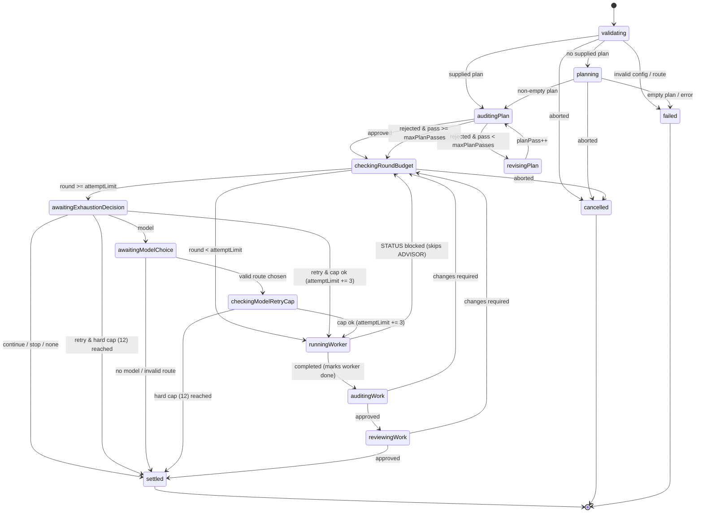
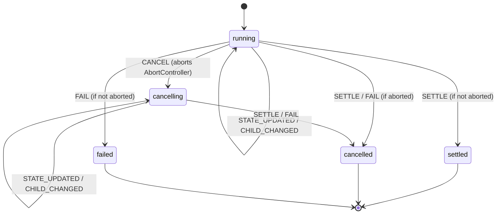
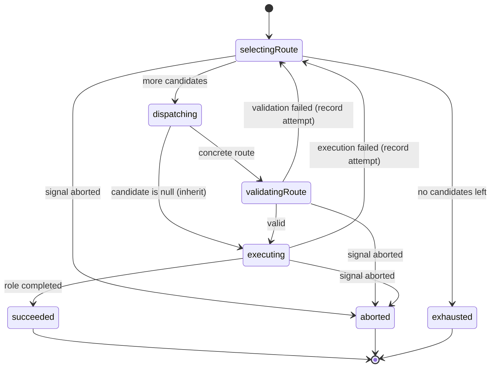
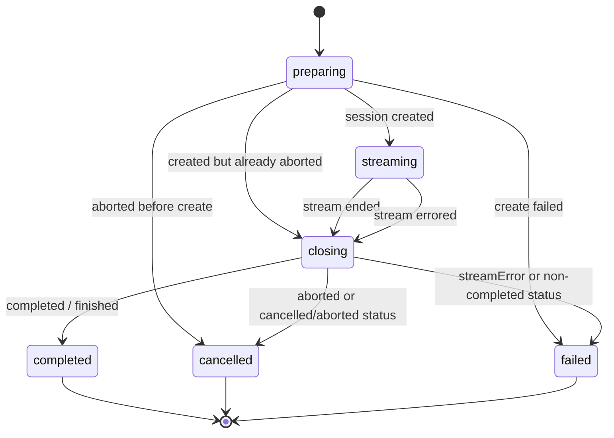

# DSH Role Team Architecture & State Machines

`@local/dsh-role-team` orchestrates four independent AI engineering roles (**PLAN → WORKER → ADVISOR → REVIEWER**) inside DeepSeek Harness (DSH). The codebase follows a clean layered architecture (matching `@local/dsh-buildboard`) with explicit finite state machines powered by **XState v5**.

## Layered Structure

```text
extensions/dsh/dsh-role-team/
├── index.ts                      # Root entrypoint facade -> src/presentation/index.js
├── client.ts                     # Classic browser script for window.__ModuleLoader__
├── types.ts / config.ts / ...    # Compatibility facades re-exporting src/*
├── src/
│   ├── index.ts                  # Main source barrel -> ./presentation/index.js
│   ├── domain/                   # Pure types, config resolution, verdict parsing, XState machines
│   │   ├── types.ts
│   │   ├── config.ts
│   │   ├── verdict.ts
│   │   └── machines/
│   │       ├── actor-events.ts
│   │       ├── background-job.machine.ts
│   │       ├── role-fallback.machine.ts
│   │       ├── runtime-role.machine.ts
│   │       └── team-pipeline.machine.ts
│   ├── application/              # Use-case coordination & in-memory state
│   │   ├── state.ts
│   │   ├── config-persistence.ts
│   │   ├── background-runs.ts
│   │   └── orchestrator.ts
│   ├── adapters/                 # Inbound/outbound DSH protocol adapters
│   │   ├── prompts.ts
│   │   ├── tools.ts
│   │   ├── commands.ts
│   │   └── http.ts
│   ├── infrastructure/           # Subagent/runtime/HTTP-auth integrations
│   │   ├── route-validation.ts
│   │   ├── native-role.ts
│   │   ├── runtime-role.ts
│   │   └── web-route-auth.ts
│   └── presentation/             # Cordis plugin lifecycle & composition root
│       └── index.ts
└── test/
    ├── machines.test.ts          # Unit tests for all XState machines & regression fixes
    ├── role-team.test.ts         # End-to-end orchestration, tools, commands, HTTP routes
    ├── background-runs.test.ts   # Background run ownership, cancellation, status questions
    ├── runtime-role.test.ts      # External runtime execution (Cursor / Factory Droid)
    ├── runtime-picker.test.ts    # Client model picker & fallback UI tests
    ├── client.test.ts            # Client ModuleLoader & timeline card tests
    └── web-route-auth.test.ts    # Loopback & LAN admission tests
```

### Dependency Rule

Dependencies strictly point inward toward `domain/`:

- **`domain/`**: Pure TypeScript contracts, route normalization, verdict parsing, and XState machine definitions. Side-effecting work is declared via `fromPromise` actor placeholders (`validateSetup`, `runPlan`, `runWorker`, etc.) and never imports Host services directly.
- **`infrastructure/`**: Implements low-level side effects (native DSH `subagents` activation, external `agentRuntime` sessions, live `llm` route validation, fail-closed `webServer` authentication).
- **`application/`**: Wires concrete actors into the domain XState machines (`runRoleTeam`, `runRoleWithFallback`, `createBackgroundRuns`), manages per-`HostContext` state (`stateFor`), and persists configuration via `configEditor`.
- **`adapters/`**: Exposes the application layer through DSH tools (`roles_*`, `role_*`), chat commands (`/roles`, `/role-plan`), prompt templates, and loopback-guarded HTTP endpoints.
- **`presentation/`**: Cordis composition root (`apply`, `inject`) registering tools, commands, HTTP routes, and system prompt guidance.

---

## Explicit Finite State Machines (XState v5)

### 1. `teamPipelineMachine` (`src/domain/machines/team-pipeline.machine.ts`)

Governs the full four-role orchestration lifecycle in `runRoleTeam()`.



Key invariants enforced by the machine:

- **Abort-first transitions**: Every async `onDone` and `onError` checks `isAborted` first so an aborted run never advances to another role.
- **Blocked worker bypass**: When `WORKER` reports `STATUS: blocked`, `auditingWork` and `reviewingWork` are skipped and `markWorkerDone` is not called.
- **Exhaustion & hard cap**: Exhausting `attemptLimit` pauses in `awaitingExhaustionDecision` (updating `liveState.phase = "awaiting_user"` via entry/exit actions) and enforces `LIMITS.maxWorkerAttempts` (`12`).

---

### 2. `backgroundJobMachine` (`src/domain/machines/background-job.machine.ts`)

Governs each background run spawned by `roles_start` or `/roles run`.



- `isBackgroundJobActive(snapshot)` is true only in `running` and `cancelling`, preventing duplicate concurrent runs in the same session while cleanup finishes.
- `backgroundJobPublicStatus(snapshot)` maps `settled` to `outcome.status` (`approved` | `unapproved` | `continued`), and otherwise returns the current machine state (`running`, `cancelling`, `cancelled`, `failed`).

---

### 3. `roleFallbackMachine` (`src/domain/machines/role-fallback.machine.ts`)

Governs ordered route selection across `[primary, ...fallbacks]` for any role call (`runRoleWithFallback`).



- Candidate routes are deduplicated preserving priority order.
- An aborted `AbortSignal` transitions immediately to `aborted` without trying subsequent fallbacks.
- If a fallback succeeds after earlier failures, the result carries `fallback: true` and `attempts` listing each failed route and error.

---

### 4. `runtimeRoleMachine` (`src/domain/machines/runtime-role.machine.ts`)

Governs external agent runtime sessions (`cursor` / `droid`) inside `runRuntimeRole()`.



- Guarantees `closeSession` runs whenever a runtime session was created, even on stream errors or cancellation, and ignores `close()` errors so they never mask the primary result or failure.

---

## Browser Client (`client.ts`)

DSH loads `dist/client.js` as a classic `<script>` via `window.__ModuleLoader__`, supplying only `"react"` to `factory(require)`. Because classic scripts cannot contain top-level ESM `import`/`export` statements or import npm packages at runtime, `client.ts` remains a self-contained classic script using an explicit state projection (`deriveToolCardStatus`) and bounded input validation (`parseLimitInput` inside `updateLimit`) that mirror the server state machines:

- **Live polling (`useRunState`)**: Polls `/plugin-api/role-team/run/<id>` for active background `roles_start` cards (even when collapsed) and expanded in-flight `roles_run` cards, pausing when `document.hidden === true` and stopping once a terminal status is reached.
- **Terminal precedence**: `deriveToolCardStatus` checks terminal `meta.status` before `phase === "awaiting_user"` so cancelled or failed cards never get stuck displaying `"Awaiting your decision"`.
- **Settings persistence**: `RoleTeamSection` + `ModelPicker` talk to `/plugin-api/role-team/roles` (protected by same-origin loopback checks and the `x-role-team-request: 1` header).
