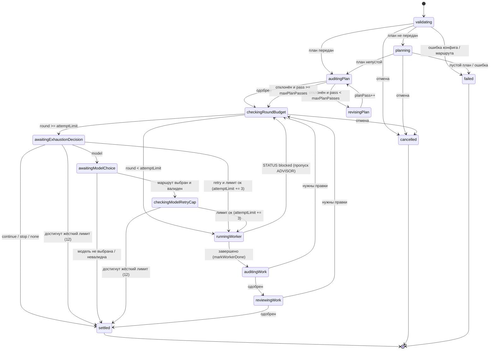
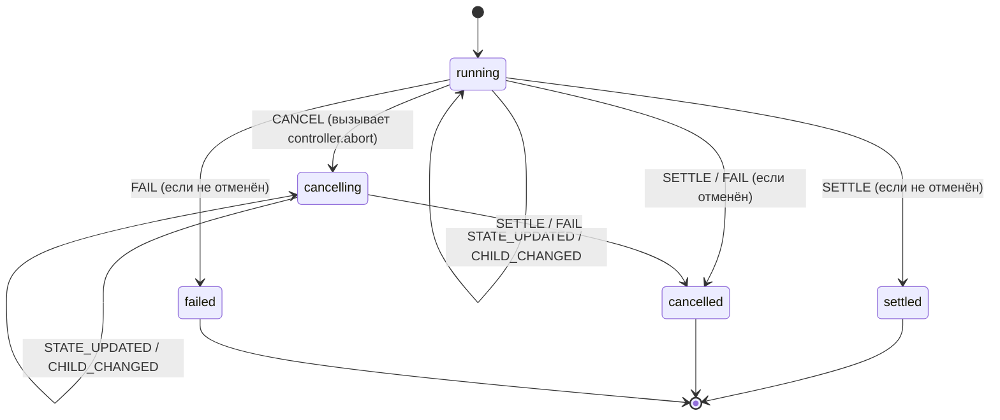
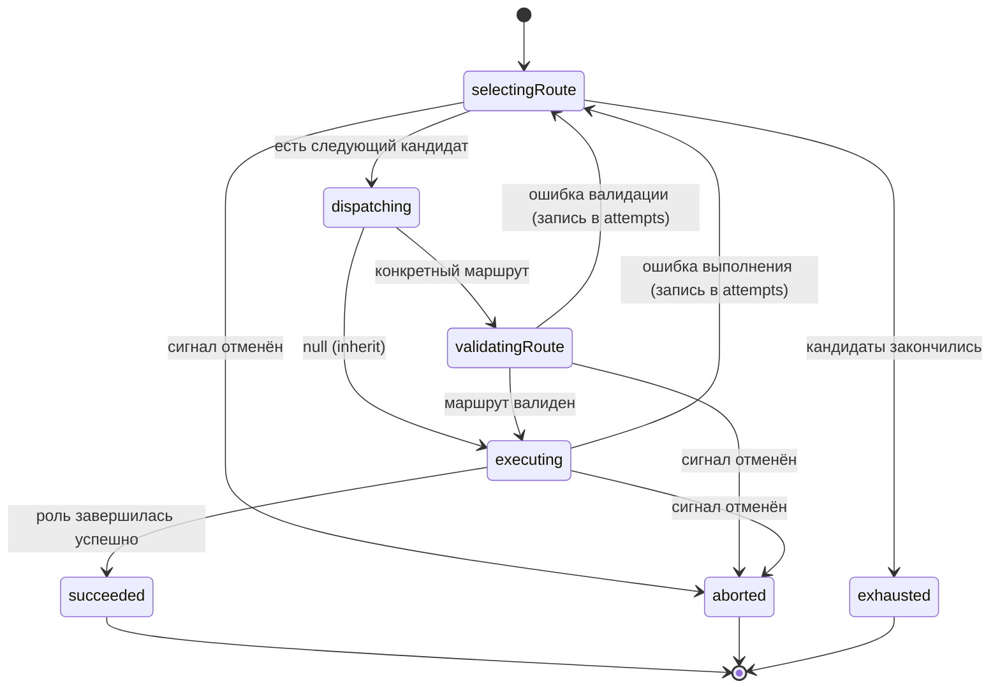
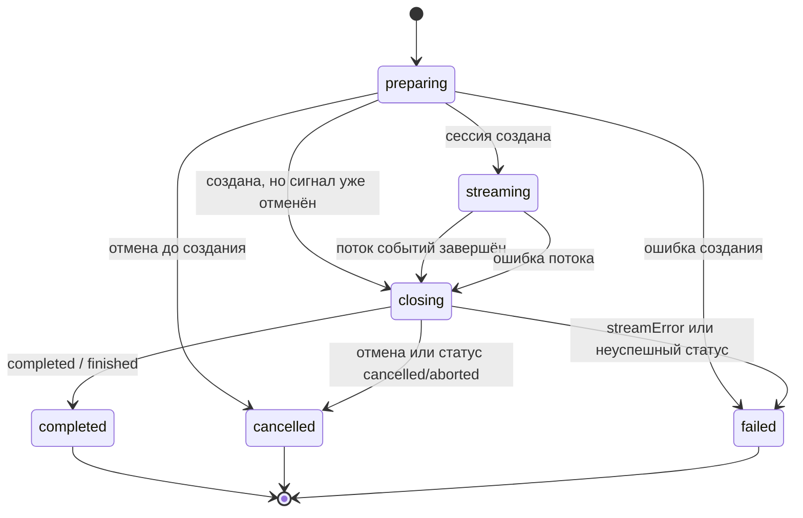

# Архитектура и конечные автоматы DSH Role Team

`@local/dsh-role-team` координирует четыре независимые инженерные роли (**PLAN → WORKER → ADVISOR → REVIEWER**) внутри DeepSeek Harness (DSH). Кодовая база организована по слоистой архитектуре (по образцу `@local/dsh-buildboard`) с явными конечными автоматами на базе **XState v5**.

## Слоистая структура

```text
extensions/dsh/dsh-role-team/
├── index.ts                      # Корневой фасад -> src/presentation/index.js
├── client.ts                     # Классический браузерный скрипт для window.__ModuleLoader__
├── types.ts / config.ts / ...    # Фасады совместимости, реэкспортирующие src/*
├── src/
│   ├── index.ts                  # Главный barrel -> ./presentation/index.js
│   ├── domain/                   # Чистые типы, разбор конфига, парсер вердиктов, XState-автоматы
│   │   ├── types.ts
│   │   ├── config.ts
│   │   ├── verdict.ts
│   │   └── machines/
│   │       ├── actor-events.ts
│   │       ├── background-job.machine.ts
│   │       ├── role-fallback.machine.ts
│   │       ├── runtime-role.machine.ts
│   │       └── team-pipeline.machine.ts
│   ├── application/              # Сценарии работы, состояние и персистентность
│   │   ├── state.ts
│   │   ├── config-persistence.ts
│   │   ├── background-runs.ts
│   │   └── orchestrator.ts
│   ├── adapters/                 # Внешние протоколы DSH (tools, commands, HTTP, prompts)
│   │   ├── prompts.ts
│   │   ├── tools.ts
│   │   ├── commands.ts
│   │   └── http.ts
│   ├── infrastructure/           # Интеграция с сабагентами, внешними рантаймами и HTTP-авторизацией
│   │   ├── route-validation.ts
│   │   ├── native-role.ts
│   │   ├── runtime-role.ts
│   │   └── web-route-auth.ts
│   └── presentation/             # Точка входа Cordis-плагина
│       └── index.ts
└── test/
    ├── machines.test.ts          # Юнит-тесты всех XState-автоматов и регрессий багов
    ├── role-team.test.ts         # Сквозные тесты оркестрации, инструментов, команд и HTTP
    ├── background-runs.test.ts   # Тесты фоновых запусков, отмены и вопросов о статусе
    ├── runtime-role.test.ts      # Тесты внешних рантаймов (Cursor / Factory Droid)
    ├── runtime-picker.test.ts    # Тесты выбора моделей и фолбеков в UI
    ├── client.test.ts            # Тесты клиентского модуля и карточек в чате
    └── web-route-auth.test.ts    # Тесты loopback/LAN-защиты маршрутов
```

### Правило зависимостей

Зависимости направлены строго внутрь — к слою `domain/`:

- **`domain/`**: чистые TypeScript-контракты, нормализация маршрутов, парсер вердиктов и определения XState-автоматов. Все побочные эффекты объявлены как абстрактные `fromPromise`-акторы (`validateSetup`, `runPlan`, `runWorker` и т.д.) — домен не зависит от сервисов Host.
- **`infrastructure/`**: низкоуровневое исполнение (нативные сабагенты DSH, внешние сессии `agentRuntime`, валидация маршрутов через `llm`, fail-closed защита `webServer`).
- **`application/`**: связывает реальные акторы с XState-автоматами (`runRoleTeam`, `runRoleWithFallback`, `createBackgroundRuns`), хранит изолированное состояние по `HostContext` (`stateFor`) и сохраняет настройки через `configEditor`.
- **`adapters/`**: предоставляет доступ к приложению через инструменты ИИ (`roles_*`, `role_*`), команды чата (`/roles`, `/role-plan`), шаблоны промптов и HTTP-маршруты.
- **`presentation/`**: композиционный корень Cordis (`apply`, `inject`), регистрирующий инструменты, команды, HTTP-маршруты и системную подсказку.

---

## Конечные автоматы (XState v5)

### 1. `teamPipelineMachine` (`src/domain/machines/team-pipeline.machine.ts`)

Управляет полным циклом работы команды ролей в `runRoleTeam()`.



Ключевые инварианты:

- **Приоритет отмены**: все переходы `onDone` и `onError` сначала проверяют `isAborted`, поэтому отменённый запуск никогда не переходит к следующей роли.
- **Заблокированный WORKER**: если `WORKER` вернул `STATUS: blocked`, этапы `auditingWork` и `reviewingWork` пропускаются, а `markWorkerDone` не вызывается.
- **Исчерпание раундов и жёсткий потолок**: при достижении `attemptLimit` автомат переходит в `awaitingExhaustionDecision` (устанавливая `phase = "awaiting_user"` через `entry`/`exit` действия) и ограничивает общее число попыток значением `LIMITS.maxWorkerAttempts` (`12`).

---

### 2. `backgroundJobMachine` (`src/domain/machines/background-job.machine.ts`)

Управляет жизненным циклом фонового запуска (`roles_start`, `/roles run`).



- `isBackgroundJobActive(snapshot)` истинно только в состояниях `running` и `cancelling`, что запрещает одновременный второй запуск в той же сессии, пока завершается очистка дочернего агента.
- `backgroundJobPublicStatus(snapshot)` для `settled` возвращает `outcome.status` (`approved` | `unapproved` | `continued`), а для остальных состояний — имя состояния автомата.

---

### 3. `roleFallbackMachine` (`src/domain/machines/role-fallback.machine.ts`)

Управляет перебором основного маршрута и цепочки фолбеков (`runRoleWithFallback`).



- Дубликаты маршрутов удаляются с сохранением приоритета.
- Отмена `AbortSignal` немедленно переводит автомат в `aborted` без попыток следующих фолбеков.
- Если сработал фолбек после ошибок предыдущих маршрутов, результат помечается `fallback: true` и сохраняет список `attempts`.

---

### 4. `runtimeRoleMachine` (`src/domain/machines/runtime-role.machine.ts`)

Управляет сессией внешнего рантайма (`cursor` / `droid`) в `runRuntimeRole()`.



- Гарантирует вызов `closeSession` для любой созданной сессии, даже при ошибке потока или отмене, и игнорирует ошибки `close()`, чтобы не скрыть основную причину.

---

## Браузерный клиент (`client.ts`)

DSH загружает `dist/client.js` как классический `<script>` через `window.__ModuleLoader__`, передавая в `factory(require)` только `"react"`. Поэтому `client.ts` намеренно остаётся автономным классическим скриптом без верхнеуровневых `import`/`export`, но использует явную проекцию состояний (`deriveToolCardStatus`) и валидацию числовых лимитов (`updateLimit`):

- **Живой опрос (`useRunState`)**: опрашивает `/plugin-api/role-team/run/<id>` для активных фоновых карточек `roles_start` (даже в свёрнутом виде) и раскрытых активных `roles_run`, ставит опрос на паузу при `document.hidden === true` и останавливается на терминальных статусах.
- **Приоритет терминальных статусов**: `deriveToolCardStatus` проверяет терминальный `meta.status` раньше `phase === "awaiting_user"`, чтобы отменённые или упавшие карточки не зависали в статусе «Ожидает решения».
- **Защита числовых полей**: `updateLimit` отправляет запрос только при непустом целом числе в допустимом диапазоне, предотвращая случайную запись `0` при очистке поля ввода.
